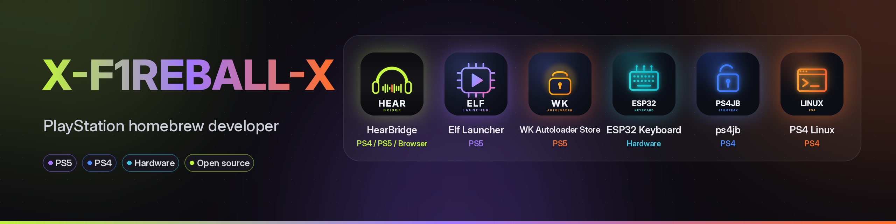

Hi, I'm X-F1REBALL-X. I make homebrew for PS4 and PS5: jailbreak hosts, a payload launcher, Bluetooth audio tools, a Linux port, and a small ESP32 keyboard. Everything below is free and open source.

## PS5

| Project | What it does |
|---|---|
| [HearBridge PS5](https://github.com/X-F1REBALL-X/HearBridge-PS5) | Play PS5 game audio on regular Bluetooth headphones or earbuds, no dongle. |
| [Elf Launcher](https://github.com/X-F1REBALL-X/elf-launcher) | Home screen and browser ELF payload launcher for a jailbroken PS5. |
| [WK Autoloader Store](https://github.com/X-F1REBALL-X/wk-autoloader) | PS5 jailbreak installed on the Store tile. Runs Relapse, then opens Elf Launcher. |
| [HearBridge Browser](https://github.com/X-F1REBALL-X/HearBridge-Browser) | Stream PS5 console audio to any browser on your local network. |

## PS4

| Project | What it does |
|---|---|
| [HearBridge PS4](https://github.com/X-F1REBALL-X/HearBridge-PS4) | Play PS4 game audio on regular Bluetooth headphones, earbuds or speakers with a USB dongle and GoldHEN. |
| [ps4jb](https://github.com/X-F1REBALL-X/ps4jb) | Browser jailbreak host, firmware 6.00 to 13.52. |
| [PS4-Linux](https://github.com/X-F1REBALL-X/PS4-Linux) | Arch Linux KDE on PS4. Tested on CUH-7116B Pro and CUH-2116A Slim, firmware 13.52. |

## Hardware

| Project | What it does |
|---|---|
| [ESP32 Keyboard for WK Autoloader Store](https://github.com/X-F1REBALL-X/esp32-keyboard-wk-autoloader-store) | ESP32 Keyboard for WK Autoloader Store. ESP32-S3 and ESP32-S2 Mini. |

 

If one of these helps you, a star or a coffee is always appreciated.
